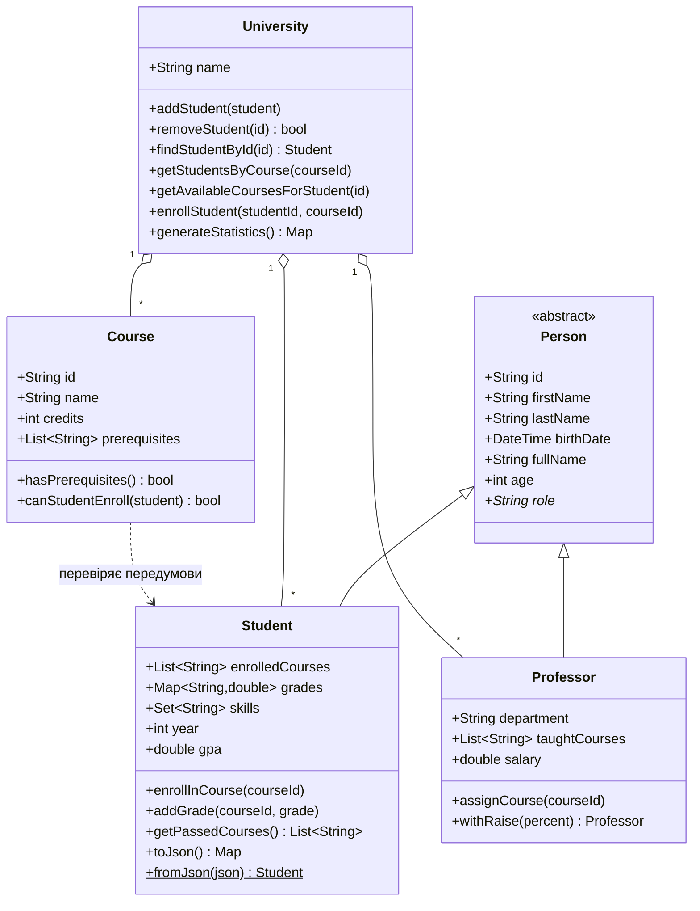

# dart-basics-kuchkovyi

Практична робота 4 «Основи мови Dart»
Кучковий Єгор, група Ік-42.

Проєкт містить 5 консольних програм та невелику бібліотеку **University Management System**
(моделі `Student`, `Course`, `Professor`, `University`, утиліти для обробки даних).


## Приклад використання класів

```dart
import 'package:dart_basics_kuchkovyi/models/course.dart';
import 'package:dart_basics_kuchkovyi/models/student.dart';
import 'package:dart_basics_kuchkovyi/models/university.dart';

void main() {
  final uni = University(name: 'МНТУ');
  uni.addCourse(Course(id: 'PRG101', name: 'Основи', description: '', credits: 5, instructor: 'Клименко'));
  uni.addStudent(Student(id: 'S1', firstName: 'Іван', lastName: 'Петренко', birthDate: DateTime(2004, 3, 15)));
  uni.enrollStudent('S1', 'PRG101');
  uni.findStudentById('S1')!.addGrade('PRG101', 85);
  print(uni.generateStatistics());
}
```

## UML-діаграма



## Структура

```
bin/   - 5 консольних програм
lib/models/  - person, student, course, university
lib/utils/   - calculator, data_processor (+ TextAnalyzer)
test/  - unit-тести
data/  - students.csv (sample data)
```
